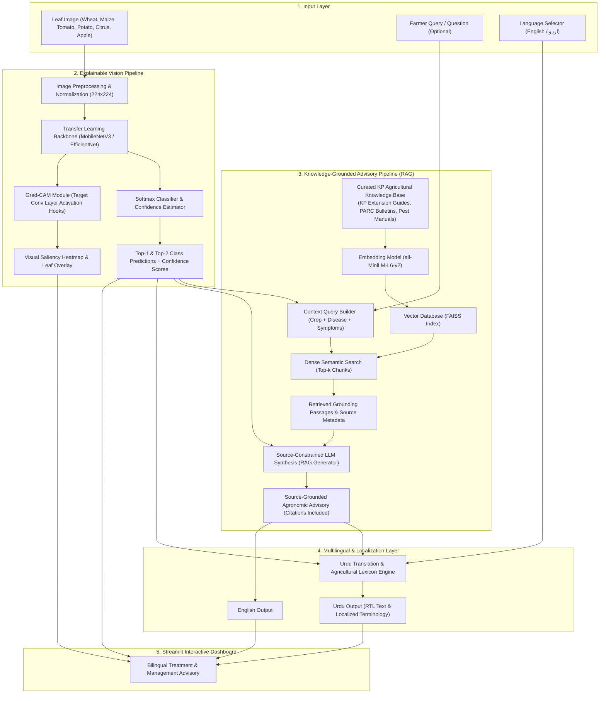

# KP Smart Crop Doctor 🌿🔍

> **An Explainable, Knowledge-Grounded Agricultural Advisory System for Khyber Pakhtunkhwa (KP)**  
> *AI/ML University Capstone Project*

---

## 📌 Executive Summary

Agriculture is the lifeblood of Khyber Pakhtunkhwa (KP), supporting millions of livelihoods across regions like Swat, Mardan, Charsadda, Swabi, Peshawar, D.I. Khan, and the Hazara division. However, smallholder farmers face severe crop losses due to foliar diseases in high-value and staple crops (wheat, maize, citrus, tomato, potato, apple).

Traditional advisory services are hampered by geographic remoteness and severe shortages of agricultural extension officers. Existing AI solutions often fall short:
- **Black-box Deep Learning:** Vision models make high-stakes disease predictions without visual justification or lesion localization, breeding skepticism among farmers.
- **Hallucinating LLMs:** Generic Large Language Models invent chemical treatments, suggest non-existent pesticides, or ignore provincial agro-ecological suitability and local regulatory bans.
- **Language Barriers:** Most tools are English-only, whereas KP farmers primarily communicate in Urdu and regional languages.

**KP Smart Crop Doctor** solves these challenges by combining:
1. **Transfer Learning Vision Classifier** (Top-1 and Top-2 predictions with uncertainty scoring).
2. **Visual Explainability via Grad-CAM** (Saliency heatmaps highlighting leaf lesions).
3. **Retrieval-Augmented Generation (RAG)** grounded strictly in curated KP agricultural extension literature and verified pest management manuals.
4. **Bilingual Advisory System** delivering actionable recommendations in both **English** and **Urdu**.
5. **Interactive Streamlit Web Dashboard** built for accessible field and desktop use.

---

## 🏛️ System Architecture



---

## 📂 Repository Directory Layout

```
kp-smart-crop-doctor/
├── data/
│   ├── raw/                 # Original image datasets (git-ignored)
│   ├── processed/           # Normalized, resized, verified images (git-ignored)
│   └── splits/              # Deterministic CSV manifests (train.csv, val.csv, test.csv)
├── docs/
│   └── DEVELOPMENT_PLAN.md  # 8-Milestone engineering roadmap and capstone specifications
├── evaluation/
│   ├── __init__.py
│   ├── metrics.py           # Top-1/Top-2 accuracy, F1, confusion matrices
│   └── rag_eval.py          # Groundedness, faithfulness, hallucination checks
├── knowledge_base/
│   ├── documents/           # Official KP extension guides, PARC bulletins (PDF/MD/TXT)
│   ├── metadata/            # Crop taxonomy, disease manifests, zone registry
│   └── vector_store/        # Serialized FAISS indices and chunk embeddings
├── models/
│   └── checkpoints/         # Trained PyTorch model weights (.pt files)
├── notebooks/               # Research prototypes and exploratory data analysis
├── src/
│   ├── __init__.py
│   ├── config.py            # Central configuration, file paths, seeds, thresholds
│   ├── utils.py             # Reproducibility seed management, device selection, logging
│   ├── app/
│   │   ├── __init__.py
│   │   └── ui_components.py # Streamlit UI widgets, layout templates, RTL styling
│   ├── data/
│   │   ├── __init__.py
│   │   ├── preprocess.py    # Image cleaning, transformation, split manifest generator
│   │   └── dataset.py       # PyTorch Dataset and DataLoader implementations
│   ├── explainability/
│   │   ├── __init__.py
│   │   └── gradcam.py       # Custom Grad-CAM feature map and gradient hook engine
│   ├── rag/
│   │   ├── __init__.py
│   │   ├── kb_indexer.py    # Document chunker, metadata extractor, embedding builder
│   │   ├── retriever.py     # FAISS similarity search & passage ranker
│   │   ├── generator.py     # Grounded LLM advisory prompt builder & client
│   │   └── translator.py    # English <-> Urdu agricultural translation engine
│   └── vision/
│       ├── __init__.py
│       ├── model.py         # MobileNetV3 / EfficientNet transfer learning architecture
│       ├── train.py         # Reproducible training pipeline with validation checkpoints
│       └── predict.py       # Top-k inference and softmax confidence pipeline
├── tests/
│   ├── __init__.py
│   ├── test_environment.py  # Scaffolding and reproducibility test suite
│   ├── test_vision.py       # Vision forward pass and inference tests
│   ├── test_gradcam.py      # Grad-CAM heatmap generation tests
│   └── test_rag.py          # Vector retrieval and prompt grounding tests
├── .env.example             # Template for API keys, device, and hyperparameters
├── .gitignore               # Strict gitignore for heavy binaries, datasets, and credentials
├── app.py                   # Streamlit web application entrypoint
├── requirements.txt         # Pinned project dependencies
└── README.md                # Project documentation
```

---

## 🚀 Getting Started

### 1. Prerequisites
- **Operating System:** Windows 10/11, Ubuntu 20.04+, or macOS
- **Python:** 3.10 – 3.14
- **Hardware:** CPU supported; CUDA-compatible GPU recommended for training

### 2. Installation
Clone the repository and set up a virtual environment:
```bash
git clone https://github.com/your-username/kp-smart-crop-doctor.git
cd kp-smart-crop-doctor

# Create and activate virtual environment
python -m venv .venv
# On Windows:
.venv\Scripts\activate
# On Linux/macOS:
source .venv/bin/activate

# Install required dependencies
pip install -r requirements.txt
```

### 3. Environment Configuration
Copy `.env.example` to `.env` and configure your environment:
```bash
cp .env.example .env
```
Key configuration parameters:
- `DEVICE`: `auto`, `cuda`, or `cpu`
- `VISION_MODEL_BACKBONE`: `mobilenet_v3_large` (default) or `efficientnet_b0`
- `CONFIDENCE_THRESHOLD`: Probability threshold (default `0.60`) below which the system flags classification ambiguity
- `RANDOM_SEED`: Fixed seed (default `42`) ensuring full reproducibility

### 4. Verification Test
Verify that the environment and project scaffolding are properly configured:
```bash
pytest tests/test_environment.py -v
```

---

## 🎯 Capstone Development Milestones

The project is structured into 8 structured milestones (see [docs/DEVELOPMENT_PLAN.md](file:///c:/Users/DELL/Downloads/kp-smart-crop-doctor/docs/DEVELOPMENT_PLAN.md) for full details):

| Milestone | Focus | Key Deliverables | Status |
|:---:|:---|:---|:---:|
| **M1** | Scaffolding & Architecture | Directory structure, configs, seeds, tests, requirements | **Completed** |
| **M2** | Dataset Curation (KP Crops) | 11-class subset (Maize, Potato, Apple), leak-free leaf-group splits | **Completed** |
| **M3** | Transfer Learning Vision Model | MobileNetV3-Large training, Top-2 head, EfficientNet comparison | **Completed** |
| **M4** | Explainable AI (Grad-CAM) | Activation hooks on `features.16`, Adebayo sanity check, overlays | **Completed** |
| **M5** | Agricultural Knowledge Base & RAG | 11 curated KP bulletins, FAISS index, provenance catalog | **Completed** |
| **M6** | Multilingual Advisory Generation | Grounded synthesis, 33-term glossary, entity-safe Urdu translation | **Completed** |
| **M7** | Interactive Streamlit App | Complete web dashboard, interactive opacity slider, bilingual RTL UI | **Completed** |
| **M8** | Evaluation & Defense Pack | [Results Summary](docs/RESULTS_SUMMARY.md), [Capstone Defense Pack](docs/DEFENSE_PACK.md) | **Completed** |

---

## 📊 Comprehensive Results & Capstone Defense Pack

- **Key Numerical Findings & Tables:** See [docs/RESULTS_SUMMARY.md](docs/RESULTS_SUMMARY.md) for full test metrics, baseline comparisons, Grad-CAM sanity checks, RAG retrieval scores, end-to-end latencies, and the 34-case error analysis.
- **Academic Capstone Defense Pack:** See [docs/DEFENSE_PACK.md](docs/DEFENSE_PACK.md) for the 19-section defense reference covering problem formulation, methodology, leakage prevention, limitations, ethical safeguards, and likely viva defense questions and answers.

---

## 🔬 Reproducibility & Research Standards

To ensure academic and university capstone excellence:
- **Deterministic Seeding:** PyTorch, NumPy, and Python standard libraries are seeded identically (`src.utils.set_seed(42)`).
- **No Data Leakage:** All splits are generated strictly before model training and locked via SHA-256 manifests.
- **Strict Grounding:** The RAG generator is constrained by prompt design and document verification to prevent chemical treatment hallucinations.
- **Comprehensive Unit Tests:** Every component includes dedicated unit tests in `tests/`.

---

## 👥 Authors & Academic Context

* **Project:** KP Smart Crop Doctor
* **Course:** Final Year AI/ML Capstone Project
* **Institution:** Department of Computer Science / Artificial Intelligence
* **Target Geographic Region:** Khyber Pakhtunkhwa, Pakistan
